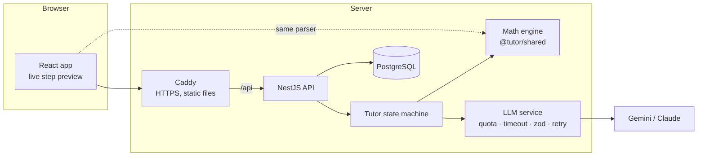

# AI Math Tutor

A working prototype of an AI mathematics tutor inspired by Soviet school mathematics: the
student does the thinking, the tutor finds the **exact step** where the reasoning went wrong,
guides with questions instead of answers, and then checks with a **new, personalised problem**
that the lesson stuck.

**Live demo:** https://tutor.florik.pp.ua — click **“Try as a demo student”** (no sign-up), then
open the **test scenario** `3(x + 4) = 2x + 19` and type the classic wrong step `3x + 4 = 2x + 19`.

|          |                                                                                                 |
| -------- | ----------------------------------------------------------------------------------------------- |
| Frontend | React 19, Vite, TypeScript, Tailwind CSS 4, TanStack Query, KaTeX                               |
| Backend  | NestJS 11, PostgreSQL, Drizzle ORM (SQL migrations), zod                                        |
| AI       | Google Gemini (default) or Anthropic Claude via a thin provider adapter, structured JSON output |
| Infra    | Docker, Caddy (automatic HTTPS), GitHub Actions → GHCR → VPS                                    |
| Quality  | Vitest + fast-check (math engine), Vitest (React), Jest + Supertest e2e, type-aware ESLint      |

---

## The test scenario, step by step

1. **Detect.** The student writes `3x + 4 = 2x + 19`. The math engine expands both lines and
   compares their solution sets: the previous line gives `x = 7`, the new one `x = 15`, so the
   error happened _in this transformation_ — a fact, not a guess. The ✗ appears in the
   notebook as soon as the line is sent: the same engine runs in the browser.
2. **Diagnose.** The model receives those computed facts (expanded sides, both solutions,
   what `x = 7` gives when substituted) and classifies the mistake: `DISTRIBUTION` —
   _“multiplied only the first term in the bracket”_.
3. **Guide, don’t solve.** A three-level hint ladder:
   1. a Socratic question pointing at the place of the error;
   2. the rule, illustrated on a _different_ example;
   3. the corrected step with a one-line justification.
      The level rises only when the student is still stuck (asks for help, guesses, or writes
      another wrong line). The final answer is never given. Every prompt also carries a short
      **profile of the student’s earlier mistakes** (e.g. `SIGN_TRANSFER ×2, 1 verified`), so the
      tutor can connect a slip to a recurring pattern instead of explaining from scratch.
4. **Correct.** When the student writes any line equivalent to the last correct one
   (`3x + 12 = 2x + 19`, `3x − 2x = 19 − 12`, `6x + 24 = 4x + 38` …) the mistake is marked
   _corrected_ — there is no single “expected path”.
5. **Check the answer, as at school.** Reaching `x = 7` does not close the problem: the tutor asks
   the student to substitute it into the **original** equation and compute both sides,
   `3(7 + 4) = 2·7 + 19` → `33 = 33`. The engine judges every check line exactly (both sides
   must equal the value the original equation takes at the root, in any order, however far
   simplified). A calculation slip (`33 = 32`) is an `ARITHMETIC` mistake with the same hint
   ladder; a line that is not this substitution gets a short explanation. The check can be
   skipped (with a confirmation); Progress shows the share of problems solved with a check.
6. **Verify.** After the problem is solved and checked (or the check skipped), the model generates a similar problem aimed at the
   same misconception (e.g. `5(x − 2) = 3x + 4`). The math engine acts as a referee: it must be
   linear, have one whole-number solution, be new, and _contain the same trap_ (a bracket with a
   coefficient). Rejected proposals go back to the model with the reason; a verified template is
   the last resort. Solving it without repeating the error marks the mistake **verified** (a slip
   while checking the practice problem does not count as repeating it).
7. **Track.** Steps, accuracy, mistakes by type (total / corrected / verified), per-skill mastery
   and a 14-day activity chart on the Progress page. The next problem is recommended from the
   weakest skill within reach.

## Technical approach



**The key decision: the math engine decides _whether_ a step is right; the LLM explains _why_.**
LLMs are unreliable at arithmetic and at judging equivalence, and a tutor that marks a correct
step wrong destroys trust. So `packages/shared` contains a small, exact engine:

- a **safe parser** — mathjs is used only to build a syntax tree, never `evaluate`; a whitelist
  walker reduces each side to `a·x + b` with exact rational arithmetic (no floats), and rejects
  functions, strings, non-linear terms, division by `x`, etc.;
- **step checking** by solution-set comparison, so every valid transformation is accepted;
- input normalisation for how students actually type: `−`, `×`, `·`, `:` for division, `2,5`.

The same package runs in the browser (live preview, “step vs question” detection) and on the
server, and also holds the zod schemas for the API contract.

**Tutor state machine** (`apps/api/src/tutor/tutor.service.ts`): `SOLVING → REMEDIATION (hint 1→2→3)
→ SOLVING → CHECKING (substitution; a slip climbs the same ladder) → SOLVED → follow-up`. The
root is not in any API response until the student reaches it (`solutionLatex` stays null). A turn makes one model call with a typed JSON response; the
turn that finishes the check (or skips it) makes two (generate the follow-up problem, then the
celebration that points at it); lines of the check get fixed copy, a model call only for a slip.
All calls of a turn share one time budget (25 s by default), so a slow model degrades a single
message instead of hanging the request. A turn reads, checks with the engine, calls the model, and
only then writes everything in **one transaction** (no transaction is open while the model
thinks; a failure leaves the attempt as it was). Queries live in `AttemptRepository`; the service
keeps only the state machine. Overlapping turns on one attempt (double clicks, two tabs, two API
instances) get 409 BUSY from a lease in the attempt row (`busy_until` + `busy_token`), taken with
one conditional `UPDATE … RETURNING` and released by its holder. All pedagogy (system prompt, error taxonomy, hint ladder,
prompts per turn type) is in one file, `apps/api/src/llm/prompts.ts`. Everything the student
typed — steps, questions, earlier dialogue — is passed as delimited data, and the prompt forbids
following instructions inside it.

**Why no LangChain / LangGraph.** The flow is a small explicit state machine with state in
Postgres; a framework would hide it behind abstractions. The provider port (`LlmProvider`) is
~20 lines per vendor. LangGraph becomes worthwhile with multi-agent flows, long tool loops or a
voice agent — see scaling below.

**Reliability.** Structured output is validated with zod; an invalid answer is retried once with
the validation error fed back. Timeouts, 429s and quota exhaustion degrade gracefully: the math
engine still tells the student whether each step is right, and the UI says the AI is offline.

**Security (public demo).** Session JWT in an `httpOnly`, `SameSite=Lax`, `Secure` cookie;
argon2id password hashes with timing-safe login; JSON-only writes (CSRF defence); no CORS (same
origin via Caddy); helmet + strict CSP; per-IP rate limits; **daily per-user and global LLM
quotas** stored in the DB; input length limits. The demo button creates an isolated account each
time, so reviewers never share state.

**Progress model.** Mistakes are typed (`DISTRIBUTION`, `SIGN_TRANSFER`, `COMBINING_LIKE_TERMS`,
`INVERSE_OPERATION`, `ONE_SIDE_ONLY`, `ARITHMETIC`), mapped to skills, and each skill keeps a
mastery score — an exponential moving average of outcomes (clean solve 1.0, solved with
mistakes 0.7, corrected 0.6, mistake 0).

## Project structure

```
apps/
  api/            NestJS API: auth, tutor state machine, LLM adapters, progress
    drizzle/      SQL migrations (applied on boot)
    test/         e2e test of the whole scenario
  web/            React app (EN / UK), Dockerfile = Caddy + static build
packages/
  shared/         math engine + API contracts, used by both apps
deploy/           Caddyfile, production compose file, server bootstrap script
.github/workflows CI (typecheck, format, tests, build) and CD (GHCR + SSH deploy)
```

## Run it locally

**Everything in Docker** (needs a Gemini key from [aistudio.google.com](https://aistudio.google.com)):

```bash
cp .env.example .env          # set GEMINI_API_KEY and JWT_SECRET
docker compose up --build     # → http://localhost:8080
```

**Development** (Node 22, pnpm 10):

```bash
pnpm install
cp .env.example .env          # set GEMINI_API_KEY and JWT_SECRET
pnpm db:up                    # Postgres in Docker on :5433
pnpm dev                      # API on :3100, web on http://localhost:5173
pnpm smoke:llm                # check the key/model: runs the scenario prompts against the real model
```

**Tests:**

```bash
pnpm db:up                    # the dev database also creates tutor_test
pnpm test                     # math engine, React components, API unit + e2e
pnpm lint                     # type-aware ESLint (floating promises, react-hooks)
```

The math engine also has property-based tests (`packages/shared/src/math/equation.property.test.ts`,
fast-check): random linear equations with brackets, fractions and `x` on both sides are solved by
an independent bigint oracle; every valid transformation must be accepted, a typical mistake
must be flagged exactly when it changes the solution set, notation (`−`, `×`, `:`, `2,5`, spaces)
must not change the result, and any input up to 120 characters must either parse or throw a
`MathInputError`. On failure fast-check prints `seed` and `path` for a replay.

The e2e test drives the full scenario (wrong step → hint ladder → correction → solve →
follow-up → verified) through HTTP against a real database, with a deterministic mock model
(allowed only outside production).

## Evaluating the tutor

The math engine decides correctness; the model diagnoses _why_ a step is wrong and writes the
hints. `pnpm eval` measures that part against a real model, so a prompt or model change becomes a
number instead of an impression.

```bash
pnpm eval --model gemini-3.5-flash-lite     # all 54 cases → apps/api/evals/reports/<date>-<model>.md
pnpm eval --only SIGN_TRANSFER --limit 4    # a quick look at one category
pnpm eval --resume apps/api/evals/reports/<file>.json   # finish a run cut short by the daily quota
pnpm eval --rescore apps/api/evals/reports/<file>.json  # re-apply changed checks offline → <file>-rescored
```

- **Cases** (`apps/api/evals/cases.ts`): 54 wrong steps, 8 per error type (6 for `OTHER`), half EN
  and half UK, each with the category a teacher would give it and the step a teacher would accept.
  Before running, the engine must agree that every wrong step is wrong and every accepted step is
  right. An invalid case stops the run.
- **Calls**: per case, the diagnosis (which is also hint level 1) and hint levels 2 and 3. These use
  the production prompt functions, zod schemas and `callStructured`, the same validation and retry
  the API uses. There is no database and no server.
- **Metrics**:
  - error-type accuracy, with a breakdown per type and per locale and a confusion matrix;
  - invalid JSON on the first try;
  - latency p50 / p95;
  - hint rules: level 1 is a question; no level gives away the final answer in any form; level 3
    shows the corrected current step and nothing beyond it; the reply is in the student's language.
- **How the hint rules are checked**: equations and expressions are extracted from the LaTeX and
  compared by the math engine, not by string matching. The checks are heuristics with unit tests
  (`apps/api/evals/*.spec.ts`). Reports keep the raw answers, so an improved check is re-applied
  with `--rescore`.

Results for `gemini-3.5-flash-lite` (reports in `apps/api/evals/reports/`):

| Run                                                | Cases | Error type accuracy | Invalid JSON | Latency p50 / p95 | L1 is a question | No final answer | L3 rule | Language matches | LaTeX intact |
| -------------------------------------------------- | ----- | ------------------- | ------------ | ----------------- | ---------------- | --------------- | ------- | ---------------- | ------------ |
| Baseline, original checks                          | 54    | 75.9% (41/54)       | 0.0%         | 916 / 1408 ms     | 100%             | 100%            | 85.2%   | 100%             | —            |
| Baseline answers, current checks (`--rescore`)     | 54    | 75.9% (41/54)       | 0.0%         | 916 / 1408 ms     | 100%             | 98.8%           | 96.3%   | 100%             | 99.4%        |
| Current prompts (`-2`, stopped by the daily quota) | 47    | 78.7% (37/47)       | 0.0%         | 1081 / 3058 ms    | 100%             | 100%            | 97.8%   | 100%             | 100%         |
| `message` last + `propertyOrdering` (`-3`)         | 54    | 79.6% (43/54)       | 0.0%         | 912 / 1154 ms     | 100%             | 100%            | 96.3%   | 100%             | 100%         |

`gemini-3.6-flash` is measured below, after phases 2–5.

The `-3` run checks the field order (the model decides before it writes; Gemini also gets
`propertyOrdering`). On the same 54 cases it scores 43 against the baseline's 41: four cases
flipped, three of them up. For diagnosis the order was already `message` last, so this is
within run-to-run noise. The change is kept: nothing got worse.

What the numbers say:

- **Diagnosis did not change beyond noise.**
  - On the same 47 cases the baseline scored 40/47 and the current prompts 37/47.
  - One of those cases is a 503 outage, not a wrong answer. On the 46 cases both runs answered,
    it is 39/46 vs 37/46: four cases flipped (three down, one up).
  - The diagnosis prompt changed by one sentence (doubling LaTeX backslashes), and diagnosis runs
    at temperature 0.3, so a ±2 swing is run-to-run noise.
- **Four categories are solid.** `DISTRIBUTION`, `SIGN_TRANSFER`, `COMBINING_LIKE_TERMS` and
  `INVERSE_OPERATION` score 8/8 in every run (one 503 aside).
- **The weak spots:**
  - `ONE_SIDE_ONLY` (2–4/8) is read as combining, inverse operation or arithmetic.
  - `ARITHMETIC` (4–5/8) is read as a sign or distribution error when the slip happens in that
    step.
  - `OTHER` (0/6) is always forced into a named category. Some of those labels are arguable (for
    example, `3x + 6 → 3x + 6x` does look like combining), so read the confusion matrix, not only
    the total.
- **Level 3.** When the corrected step would be the answer (`4x = 20 → x = 5`), level 3 now names
  the operation and the line ("divide both sides of 4x = 20 by 4") instead of saying nothing
  useful. The rule check went from 85.2% to 97.8%. Most of that gain comes from the new check,
  which accepts naming the operation: the re-scored baseline already reaches 96.3%. The prompt
  change removes the contradiction that caused the failures.
  - The eval counts `x = 35 : 5` as giving the answer away, the same way it counts `x = 14/2`.
- **LaTeX.** One answer in about 160 had `\times` broken by JSON escaping. The API now repairs
  it before use (`repairLatexEscapes`), and the eval reports how often the raw answer was broken.

### After phases 2–5: gemini-3.5-flash-lite vs gemini-3.6-flash

Both models on the current code, the same 54 cases, against the baseline before phases 2–5 (its
answers re-scored with the current checks). The report `2026-11-09-gemini-3.5-flash` was requested
as `gemini-3.5-flash`, which the API now serves with `gemini-3.6-flash` (see the Gemini API
deprecations page), so it is labelled `gemini-3.6-flash` here. The last row is the production setup:
diagnosis and hints on `gemini-3.6-flash` (`2026-11-09-gemini-3.6-flash`).

| Run                                               | Error type accuracy | Invalid JSON | Latency p50 / p95 | L1 is a question | No final answer | L3 rule | Language matches | LaTeX intact |
| ------------------------------------------------- | ------------------- | ------------ | ----------------- | ---------------- | --------------- | ------- | ---------------- | ------------ |
| Baseline, `gemini-3.5-flash-lite` (re-scored)     | 75.9% (41/54)       | 0.0%         | 916 / 1408 ms     | 100%             | 98.8%           | 96.3%   | 100%             | 99.4%        |
| After phases 2–5, `gemini-3.5-flash-lite`         | 79.6% (43/54)       | 0.0%         | 835 / 1154 ms     | 96.3%            | 100%            | 96.3%   | 100%             | 99.4%        |
| After phases 2–5, `gemini-3.6-flash`              | **90.7% (49/54)**   | 0.0%         | 1666 / 3560 ms    | 100%             | 99.4%           | 100%    | 100%             | 100%         |
| Production setup, `gemini-3.6-flash` (second run) | **87.0% (47/54)**   | 0.0%         | 1539 / 2761 ms    | 100%             | 99.4%           | 96.3%   | 100%             | 100%         |

The check by substitution (12 slips while checking the answer, `evals/check-cases.ts`; new, so no
baseline). Every level is counted for "no value" and "no computed line" (36 hints per model):

| Model                          | L1 is a question | No value of a side | No computed line | L3 = operations, no results | Language | LaTeX intact | Latency p50 / p95 |
| ------------------------------ | ---------------- | ------------------ | ---------------- | --------------------------- | -------- | ------------ | ----------------- |
| `gemini-3.5-flash-lite`        | 100%             | 97.2% (35/36)      | 100%             | 100% (12/12)                | 100%     | 100%         | 795 / 982 ms      |
| `gemini-3.6-flash`             | 100%             | 94.4% (34/36)      | 94.4% (34/36)    | 100% (12/12)                | 100%     | 100%         | 1541 / 2392 ms    |
| `gemini-3.6-flash`, second run | 100%             | 97.2% (35/36)      | 100%             | 100% (12/12)                | 100%     | 100%         | 1422 / 3580 ms    |

What the numbers say:

- **Lite vs its baseline: within noise.** 43 against 41, after phases 2–5. No rule got worse beyond
  one or two messages: two level-1 hints were statements, not questions (`dist-3`, `arith-6`).
- **`gemini-3.6-flash` diagnoses clearly better: 49 and 47 in two runs, against 43 for lite.**
  Against lite, the first run has seven cases up and one down, the second five up and one down:
  beyond the ±2 run-to-run noise both times. The gain is in `ONE_SIDE_ONLY` (7–8/8 against 5/8),
  `ARITHMETIC` (7–8/8 against 6/8) and `OTHER` (1–2/6 against 0/6).
- **Hint rules are close.** Both models keep the ladder. Each model has one or two misses per
  rule. `gemini-3.6-flash` gave a final answer once in each run: an example `x = 10 : 2` on a
  problem whose root is also 5, and a level 3 that ends in "`x = 7`" (`comb-1`).
- **Hints for a slip in the check keep the rules.** Level 3 lists the operations without results
  for every case and model. The flagged hints are all level 2, the "different example" level:
  - `gemini-3.5-flash-lite`, `check-7`: "6 × 4 is 24, not 28". This leaks 28, the result the
    student must compute.
  - `gemini-3.6-flash`, second run, `check-1`: "2 · 6 = 12, not 14": the same "X, not Y" pattern,
    leaking 14.
  - `gemini-3.6-flash`, first run, `check-7` and `check-12`: examples on other numbers whose result
    happens to equal the value of a side (`6 · 4 = 24`, `4 · 5 + 2 = 22`). They are arguable; the
    check cannot tell a coincidence from a leak, so they stay counted.
- **`gemini-3.6-flash` is about twice as slow:** p50 1.5–1.7 s against 0.8 s, p95 2.8–3.6 s
  against 1.2 s.

**Which model where.** Diagnosis and hints run on `gemini-3.6-flash`
(`GEMINI_MODEL_DIAGNOSIS=gemini-3.6-flash,gemini-3.5-flash-lite`); everything else (step feedback,
chat, celebration, follow-up problems) stays on `gemini-3.5-flash-lite`
(`GEMINI_MODEL=gemini-3.5-flash-lite,gemini-3.6-flash`). Each list falls back to the other model on
a timeout or a 429.

- **Why.** The diagnosis is where the models differ: 47–49/54 against 43/54.
- **What it costs.** About one second, only on a wrong step and on a hint. The verdict itself is
  instant: the browser shows it before the tutor answers.
- **The level-2 leak is not fixed by the model.** Both models leaked a value once in 12 checks
  ("X, not Y"), so it is a prompt question; it is fixed below.

### Level 2 on other numbers

Level 2 teaches the broken rule on an example. With numbers from the problem the example
becomes a disguised correction, and "X, not Y" hands over a value. Both ladders now say: build
the example only on numbers that appear neither in the equation nor in the student's lines;
never contrast a right and a wrong value; state no value from the student's line, but point at
their expression as written.

The eval checks it at level 2 (step and check cases): no number of the equation or the student's
lines outside a quote of their work. A quote is an expression of theirs (its numbers all come
from one of their lines), or a signed term of theirs pointed at in place (`+12`). Both runs are
scored with the same checks; production setup, `gemini-3.6-flash`:

| Run                                                | Error type accuracy | Level 2 on other numbers (steps) | Level 2 on other numbers (check) | "X, not Y" at level 2 | No value of a side (check) | No final answer | L3 rule | Latency p50 / p95 |
| -------------------------------------------------- | ------------------- | -------------------------------- | -------------------------------- | --------------------- | -------------------------- | --------------- | ------- | ----------------- |
| Before (`2026-11-09-gemini-3.6-flash`, re-scored)  | 87.0% (47/54)       | 33.3% (18/54)                    | 8.3% (1/12)                      | 5                     | 97.2% (35/36)              | 99.4%           | 96.3%   | 1539 / 2761 ms    |
| After (`2026-11-09-gemini-3.6-flash-2`, re-scored) | 88.9% (48/54)       | 70.4% (38/54)                    | 66.7% (8/12)                     | 0                     | 91.7% (33/36)              | 100%            | 98.1%   | 1606 / 3146 ms    |

- **"X, not Y" is gone,** and level 2 keeps to other numbers twice as often. Diagnosis is
  unchanged (47 → 48, noise): only level 2 changed.
- **What is still flagged** is mostly an example whose small numbers or result happen to match
  the problem (`8y − 5y = 3y` when the student wrote `5x` and the problem has `3`). Some flags are
  the check being strict: the tutor naming the student's own coefficient as a bare number
  ("the coefficient $4$") counts against it.
- **A new leak, at level 1 of the check.** Three Ukrainian hints began with "the left side is
  right: $3 \cdot 11 = 33$", computing the side for the student. The level-1 prompt did not change
  in this fix, so this is run-to-run variance, but it is a real leak. Fixed below.

### A guard on hints for a slip in the check

Prompts reduce leaks; they cannot rule them out. So hints on a slip in the check also pass a
deterministic guard in the API (`src/tutor/check-hint-guard.ts`):

1. **What it forbids.** The engine lists the values the hint must not state: the value both sides
   take at the root, and the true values of both sides of the student's line. Numbers written in
   the original equation or in the student's line are allowed: quoting "33 = 32", or
   "$x + 5 = 12$" where the 12 on the right is the value itself, gives nothing away.
2. **One retry.** If the model's message states one of those values, the model is asked once more,
   and the request names the violation.
3. **A fixed hint.** If the retry leaks too (or fails), a fixed hint for that level is shown
   instead (`notices.checkHintTemplate`, en/uk, no numbers).

The guard covers the diagnosis of the slip and the "Hint" button. The message meta records
`guard: retried | template`, and the API logs it. Level 1 of the check's ladder now only asks
("never say which side is right with a number").

The eval runs the 12 check cases through the same guard (`pnpm eval --only CHECK`).
Production setup, `gemini-3.6-flash`:

| Run                                                                                             | L1 is a question | No value of a side | No computed line | L3 = operations, no results | L2 on other numbers | Guard: retried / template | No leak after the guard |
| ----------------------------------------------------------------------------------------------- | ---------------- | ------------------ | ---------------- | --------------------------- | ------------------- | ------------------------- | ----------------------- |
| Before (`2026-11-09-gemini-3.6-flash-2`, re-scored)                                             | 100%             | 91.7% (33/36)      | 91.7% (33/36)    | 100%                        | 66.7% (8/12)        | —                         | —                       |
| After (`2026-11-10-gemini-3.6-flash`)                                                           | 100%             | 100% (36/36)       | 100% (36/36)     | 100%                        | 75.0% (9/12)        | 1 / 0 of 36               | 100% (36/36)            |
| With the 6 cases where the equation shows the value (`2026-11-10-gemini-3.6-flash-3`, 18 cases) | 100%             | 96.3% (52/54)      | 100% (54/54)     | 100%                        | 66.7% (12/18)       | 2 / 1 of 54               | 100% (54/54)            |

The level-1 fix removed the three leaks. The guard caught one more, a level-2 example ending in
the value of the sides (40), and the retry was clean. No fixed hint was needed in this run.

**Equations that show the value themselves.** In `x + 5 = 12` and `3x − 7 = 11`, the first
curriculum problems, the value of the sides is the number on the right. The first version of the
guard forbade it, so a hint quoting the equation was retried and could end as the fixed hint. Six
check cases cover this now (`check-13` … `check-18`). In two of them the value is not in the
student's line (a miscopied right side, `7 + 5 = 13`; and `5x − 10 = 2x − 1`, where it is the
coefficient 5), so only the equation makes it allowed. The eval reports **guard false positives**:
triggers where every number caught is already written in the equation or the student's lines.

- In the 18-case run the guard acted 3 times out of 54 hints, with 0 false positives:
  - twice it caught the value of the sides (40, 33), and the retry was clean;
  - once it caught 4, the true value of the student's `14 − 10`; the retry leaked again, so the
    fixed hint was shown.
- On the same messages, the previous guard would have fired 2 more times, both false: `check-17`
  hints quoting `5 · 3`.
- The eval's wider check (it also forbids the result of the operation that slipped) found 2
  level-2 examples that end in such a result (`check-7`: 28, `check-18`: 5). The guard does not
  know which operation slipped, so these stay a prompt matter.

`pnpm eval` is not part of CI: it needs an API key and spends quota (one run is about 200
requests). By default it measures the primary model of `GEMINI_MODEL_DIAGNOSIS`, the one that
serves diagnosis and hints in production; `--model` picks another. Run it by hand after changing
prompts, schemas or the model, and commit the report next to the baseline.

## Latency: an instant verdict, no streaming (yet)

What the student waits for is the verdict on their line. The engine already runs in the
browser (`@tutor/shared`), so the notebook shows the line with its ✓ or ✗ as soon as it is
sent: the browser calls `judgeLine`, the same function the server acts on (about 0.06 ms on a
laptop), and a screen reader hears "Correct step" / "There is a mistake". The tutor's words
follow when the server answers, and its answer replaces the provisional line (a different
verdict there would be a bug; it is logged in development).

**Why the tutor's text is not streamed.** Measured with `generateContentStream` on a diagnosis
(three fields, `message` last, thinking level low, two runs per model):

| Model                 | First chunk | `message` starts | Whole answer | Chunks           |
| --------------------- | ----------- | ---------------- | ------------ | ---------------- |
| gemini-3.5-flash-lite | 0.61–1.02 s | 0.73–1.14 s      | 0.86–1.33 s  | 5 × ~100 chars   |
| gemini-3.6-flash      | 0.97–1.14 s | 1.25–1.39 s      | 1.45–1.59 s  | 4–5 × ~100 chars |

Streaming would show the text 0.2–0.3 s earlier, in two or three jumps. That does not pay for a
new protocol, mid-turn disconnects, proxy changes and a Safari workaround. It starts to pay
with longer replies, voice (speech can start on the first sentence), or slower models.

**How it would be built** (planned and checked against the docs, then deferred):

- `POST /api/attempts/:id/messages/stream` as `text/event-stream`, read with `fetch` (POST and
  cookies; same origin). Events, typed in `@tutor/shared`: `verdict` (the engine, before the
  model), `delta`, `replace` (the final validated text differs, e.g. after LaTeX repair or the
  non-streamed retry), `done {attempt}` (only after the turn's transaction commits) and
  `error`. The JSON endpoint stays, as the fallback and for tests.
- `message` is the last field of every schema, and Gemini gets `propertyOrdering` (both already
  done: the model decides before it writes). A small incremental parser takes only `message`
  out of the partial JSON; the whole answer still goes through `callStructured` (zod, LaTeX
  repair, logging, one retry), so the eval and the JSON endpoint run the same code.
- Client gone while the model writes: abort the call, write nothing, release the lock. Gone
  after the model answered: commit the turn anyway; it shows after a reload.
- Caddy: a separate `handle` for the stream path without `encode` (its default `text/*` match
  covers `text/event-stream`). No `flush_interval -1`: Caddy flushes event streams immediately
  anyway, and that mode does not cancel the upstream request when the client disconnects.
  `Cache-Control: no-cache`, `X-Accel-Buffering: no`, a heartbeat comment every 15 s.
- Safari: an open WebKit bug (Bugzilla 319542) can stall a fetch stream that goes idle after a
  burst, which is exactly verdict → model thinking → text. Test in WebKit first; fall back to
  `XMLHttpRequest` progress events behind the same parser.
- A server switch (`STREAMING_ENABLED`) that answers 503 before the first byte, so the web
  app falls back to JSON without a deploy.

## Deployment

Push to `main` → GitHub Actions runs the tests, builds two images (`api`, `web` = Caddy with the
static app) for `linux/amd64`, pushes them to GHCR and deploys over SSH:
`docker compose pull && up -d`, then waits for the API health check. If the new version is not
healthy, the deploy rolls back to the tag that was running before, checks that one, and the job
fails either way. Nothing is compiled on the server. Caddy obtains and renews the Let’s Encrypt certificate. `deploy/server/setup.sh` turns a
fresh Ubuntu VPS into a hardened Docker host (deploy user, key-only SSH, ufw, fail2ban,
unattended upgrades). The production stack fits a 2 GB VPS (memory limits per container).

## Scaling to Web, iOS and Android

- **One codebase, three platforms.** Add `apps/mobile` (Expo / React Native) to the monorepo.
  It reuses `@tutor/shared` as is: the math engine runs **on the device**, so step checking is
  instant and works offline; only explanations need the network. The API is already a clean
  JSON contract with zod schemas; mobile gets bearer tokens with refresh rotation instead of
  cookies (same auth module, second strategy).
- **Handwriting & whiteboard.** Ink strokes → a multimodal model or a dedicated math-OCR service
  → the same parser. Because correctness is checked by the engine, OCR mistakes surface as
  “I couldn’t read that step”, never as wrong grading.
- **Voice.** Streaming STT/TTS around the same turn API; this is where an agent framework such
  as LangGraph (interruptions, tool loops) starts paying off.
- **Beyond linear equations.** The engine is the extension point: inequalities, systems,
  quadratics (switch the linear form to a polynomial form or a CAS such as SymPy behind an
  internal service). The curriculum is data, so a full USSR-style programme with olympiad
  tracks is content work, not code.
- **Backend scale.** The API can already run as several replicas behind a load balancer (see
  Limitations for what is still per instance). Next: rate limits in Redis, managed
  Postgres with read replicas for dashboards, and stream tutor replies over SSE once replies get
  longer (see Latency). Cost control:
  small models for diagnosis, prompt caching, and per-plan quotas already modelled in
  `llm_calls`.
- **Parents & teachers.** The progress data (typed mistakes, verified skills) is exactly what
  a parent dashboard needs; it is a read model on the same tables.

## Limitations and next steps

Deliberate scope cuts for a three-day prototype, and what I would do next:

- **Linear equations in one variable only** — the engine is the extension point (see scaling).
- **Several API instances are supported.** State lives in Postgres: the turn lock is a lease
  in the attempt row, a turn is one transaction, a double click on "start" cannot open a second
  attempt (partial unique index), migrations run under an advisory lock on boot, and the daily
  demo cleanup runs on one instance (advisory lock). Still per instance, and fine for a demo:
  the per-IP rate limits (in-memory throttler) and the cooldown of rate-limited Gemini models.
  Shared limits would move both to Redis.
- **Re-typing the previous line** is not accepted as a correction; a line that only reorders it
  (`3(x + 4) = 19 + 2x`) still is. Understanding is verified by the follow-up problem, which
  this cannot game.
- **Replies are not streamed.** The engine's verdict shows at once in the browser; the
  tutor's text arrives whole about a second later. See
  [Latency](#latency-an-instant-verdict-no-streaming-yet) for the measurements and the plan.
- **Migrations and rollbacks.** Migrations so far only add (columns, indexes, foreign keys), so
  the previous image still runs after an automatic rollback. A migration that removes or renames
  something must be split across two releases.
- **Model choice and rate limits.** A model list per purpose: diagnosis and hints on
  `gemini-3.6-flash` (better diagnosis, about 1 s slower), everything else on
  `gemini-3.5-flash-lite`; see
  [Which model where](#after-phases-25-gemini-35-flash-lite-vs-gemini-36-flash). A
  model that answers 429 is skipped until the time the API names ("retry in 41s", or the reset of
  a daily quota at midnight Pacific time), and the next model is tried at once. When all models
  are cooling down, the API is not called at that turn; the student gets the usual "AI
  unavailable" notice and the math engine keeps checking steps. The cooldown lives in process
  memory (per replica).
