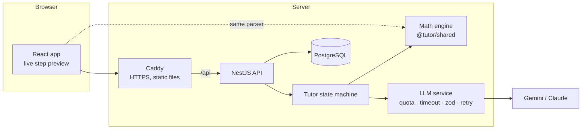

# AI Math Tutor

A working prototype of an AI mathematics tutor inspired by Soviet school mathematics: the
student does the thinking, the tutor finds the **exact step** where the reasoning went wrong,
guides with questions instead of answers, and then checks with a **new, personalised problem**
that the lesson stuck.

**Live demo:** https://tutor.florik.pp.ua — click **“Try as a demo student”** (no sign-up), then
open the **test scenario** `3(x + 4) = 2x + 19` and type the classic wrong step `3x + 4 = 2x + 19`.

|          |                                                                                                 |
| -------- | ----------------------------------------------------------------------------------------------- |
| Frontend | React 19, Vite, TypeScript, Tailwind CSS 4, TanStack Query, KaTeX                               |
| Backend  | NestJS 11, PostgreSQL, Drizzle ORM (SQL migrations), zod                                        |
| AI       | Google Gemini (default) or Anthropic Claude via a thin provider adapter, structured JSON output |
| Infra    | Docker, Caddy (automatic HTTPS), GitHub Actions → GHCR → VPS                                    |
| Quality  | Vitest + fast-check (math engine), Vitest (React), Jest + Supertest e2e, type-aware ESLint      |

---

## The test scenario, step by step

1. **Detect.** The student writes `3x + 4 = 2x + 19`. The math engine expands both lines and
   compares their solution sets: the previous line gives `x = 7`, the new one `x = 15`, so the
   error happened _in this transformation_ — a fact, not a guess.
2. **Diagnose.** The model receives those computed facts (expanded sides, both solutions,
   what `x = 7` gives when substituted) and classifies the mistake: `DISTRIBUTION` —
   _“multiplied only the first term in the bracket”_.
3. **Guide, don’t solve.** A three-level hint ladder:
   1. a Socratic question pointing at the place of the error;
   2. the rule, illustrated on a _different_ example;
   3. the corrected step with a one-line justification.
      The level rises only when the student is still stuck (asks for help, guesses, or writes
      another wrong line). The final answer is never given. Every prompt also carries a short
      **profile of the student’s earlier mistakes** (e.g. `SIGN_TRANSFER ×2, 1 verified`), so the
      tutor can connect a slip to a recurring pattern instead of explaining from scratch.
4. **Correct.** When the student writes any line equivalent to the last correct one
   (`3x + 12 = 2x + 19`, `3x − 2x = 19 − 12`, `6x + 24 = 4x + 38` …) the mistake is marked
   _corrected_ — there is no single “expected path”.
5. **Verify.** After the problem is solved, the model generates a similar problem aimed at the
   same misconception (e.g. `5(x − 2) = 3x + 4`). The math engine acts as a referee: it must be
   linear, have one whole-number solution, be new, and _contain the same trap_ (a bracket with a
   coefficient). Rejected proposals go back to the model with the reason; a verified template is
   the last resort. Solving it without repeating the error marks the mistake **verified**.
6. **Track.** Steps, accuracy, mistakes by type (total / corrected / verified), per-skill mastery
   and a 14-day activity chart on the Progress page. The next problem is recommended from the
   weakest skill within reach.

## Technical approach



**The key decision: the math engine decides _whether_ a step is right; the LLM explains _why_.**
LLMs are unreliable at arithmetic and at judging equivalence, and a tutor that marks a correct
step wrong destroys trust. So `packages/shared` contains a small, exact engine:

- a **safe parser** — mathjs is used only to build a syntax tree, never `evaluate`; a whitelist
  walker reduces each side to `a·x + b` with exact rational arithmetic (no floats), and rejects
  functions, strings, non-linear terms, division by `x`, etc.;
- **step checking** by solution-set comparison, so every valid transformation is accepted;
- input normalisation for how students actually type: `−`, `×`, `·`, `:` for division, `2,5`.

The same package runs in the browser (live preview, “step vs question” detection) and on the
server, and also holds the zod schemas for the API contract.

**Tutor state machine** (`apps/api/src/tutor/tutor.service.ts`): `SOLVING → REMEDIATION (hint 1→2→3)
→ SOLVING → SOLVED → follow-up`. A turn makes one model call with a typed JSON response; the
solving turn makes two (generate the follow-up problem, then the celebration that points at it).
All calls of a turn share one time budget (25 s by default), so a slow model degrades a single
message instead of hanging the request. All pedagogy (system prompt, error taxonomy, hint ladder,
prompts per turn type) is in one file, `apps/api/src/llm/prompts.ts`. Everything the student
typed — steps, questions, earlier dialogue — is passed as delimited data, and the prompt forbids
following instructions inside it.

**Why no LangChain / LangGraph.** The flow is a small explicit state machine with state in
Postgres; a framework would hide it behind abstractions. The provider port (`LlmProvider`) is
~20 lines per vendor. LangGraph becomes worthwhile with multi-agent flows, long tool loops or a
voice agent — see scaling below.

**Reliability.** Structured output is validated with zod; an invalid answer is retried once with
the validation error fed back. Timeouts, 429s and quota exhaustion degrade gracefully: the math
engine still tells the student whether each step is right, and the UI says the AI is offline.

**Security (public demo).** Session JWT in an `httpOnly`, `SameSite=Lax`, `Secure` cookie;
argon2id password hashes with timing-safe login; JSON-only writes (CSRF defence); no CORS (same
origin via Caddy); helmet + strict CSP; per-IP rate limits; **daily per-user and global LLM
quotas** stored in the DB; input length limits. The demo button creates an isolated account each
time, so reviewers never share state.

**Progress model.** Mistakes are typed (`DISTRIBUTION`, `SIGN_TRANSFER`, `COMBINING_LIKE_TERMS`,
`INVERSE_OPERATION`, `ONE_SIDE_ONLY`, `ARITHMETIC`), mapped to skills, and each skill keeps a
mastery score — an exponential moving average of outcomes (clean solve 1.0, solved with
mistakes 0.7, corrected 0.6, mistake 0).

## Project structure

```
apps/
  api/            NestJS API: auth, tutor state machine, LLM adapters, progress
    drizzle/      SQL migrations (applied on boot)
    test/         e2e test of the whole scenario
  web/            React app (EN / UK), Dockerfile = Caddy + static build
packages/
  shared/         math engine + API contracts, used by both apps
deploy/           Caddyfile, production compose file, server bootstrap script
.github/workflows CI (typecheck, format, tests, build) and CD (GHCR + SSH deploy)
```

## Run it locally

**Everything in Docker** (needs a Gemini key from [aistudio.google.com](https://aistudio.google.com)):

```bash
cp .env.example .env          # set GEMINI_API_KEY and JWT_SECRET
docker compose up --build     # → http://localhost:8080
```

**Development** (Node 22, pnpm 10):

```bash
pnpm install
cp .env.example .env          # set GEMINI_API_KEY and JWT_SECRET
pnpm db:up                    # Postgres in Docker on :5433
pnpm dev                      # API on :3100, web on http://localhost:5173
pnpm smoke:llm                # check the key/model: runs the scenario prompts against the real model
```

**Tests:**

```bash
pnpm db:up                    # the dev database also creates tutor_test
pnpm test                     # math engine, React components, API unit + e2e
pnpm lint                     # type-aware ESLint (floating promises, react-hooks)
```

The math engine also has property-based tests (`packages/shared/src/math/equation.property.test.ts`,
fast-check): random linear equations with brackets, fractions and `x` on both sides are solved by
an independent bigint oracle; every valid transformation must be accepted, a typical mistake
must be flagged exactly when it changes the solution set, notation (`−`, `×`, `:`, `2,5`, spaces)
must not change the result, and any input up to 120 characters must either parse or throw a
`MathInputError`. On failure fast-check prints `seed` and `path` for a replay.

The e2e test drives the full scenario (wrong step → hint ladder → correction → solve →
follow-up → verified) through HTTP against a real database, with a deterministic mock model
(allowed only outside production).

## Evaluating the tutor

The math engine decides correctness; the model diagnoses _why_ a step is wrong and writes the
hints. `pnpm eval` measures that part against a real model, so a prompt or model change becomes a
number instead of an impression.

```bash
pnpm eval --model gemini-3.5-flash-lite     # all 54 cases → apps/api/evals/reports/<date>-<model>.md
pnpm eval --only SIGN_TRANSFER --limit 4    # a quick look at one category
pnpm eval --resume apps/api/evals/reports/<file>.json   # finish a run cut short by the daily quota
pnpm eval --rescore apps/api/evals/reports/<file>.json  # re-apply changed checks to saved answers, offline
```

- **Cases** (`apps/api/evals/cases.ts`): 54 wrong steps, 8 per error type (6 for `OTHER`), half EN
  and half UK, each with the category a teacher would give it and the step a teacher would accept.
  Before running, the engine must agree that every wrong step is wrong and every accepted step is
  right. An invalid case stops the run.
- **Calls**: per case, the diagnosis (which is also hint level 1) and hint levels 2 and 3. These use
  the production prompt functions, zod schemas and `callStructured`, the same validation and retry
  the API uses. There is no database and no server.
- **Metrics**:
  - error-type accuracy, with a breakdown per type and per locale and a confusion matrix;
  - invalid JSON on the first try;
  - latency p50 / p95;
  - hint rules: level 1 is a question; no level gives away the final answer in any form; level 3
    shows the corrected current step and nothing beyond it; the reply is in the student's language.
- **How the hint rules are checked**: equations and expressions are extracted from the LaTeX and
  compared by the math engine, not by string matching. The checks are heuristics with unit tests
  (`apps/api/evals/*.spec.ts`). Reports keep the raw answers, so an improved check is re-applied
  with `--rescore`.

Baseline (2026-11-09):

| Model                   | Error type accuracy                                                | Invalid JSON | Latency p50 / p95 | L1 is a question | No final answer | L3 = corrected step only | Language matches |
| ----------------------- | ------------------------------------------------------------------ | ------------ | ----------------- | ---------------- | --------------- | ------------------------ | ---------------- |
| `gemini-3.5-flash-lite` | 75.9% (41/54)                                                      | 0.0%         | 916 / 1408 ms     | 100%             | 100%            | 85.2%                    | 100%             |
| `gemini-3.5-flash`      | _not measured: free tier allows 20 requests/day, a run needs ~160_ |              |                   |                  |                 |                          |                  |

What the numbers say:

- **The five rule-based categories are solid.** `DISTRIBUTION`, `SIGN_TRANSFER`,
  `COMBINING_LIKE_TERMS` and `INVERSE_OPERATION` all score 8/8.
- **The weak spots:**
  - `ONE_SIDE_ONLY` (4/8) is read as combining or arithmetic.
  - `ARITHMETIC` (5/8) is read as a sign or distribution error when the slip happens in that step.
  - `OTHER` (0/6) is always forced into a named category. Some of those labels are arguable (for
    example, `3x + 6 → 3x + 6x` does look like combining), so read the confusion matrix, not only
    the total.
- **Level 3 fails only when the corrected step is the final answer** (`4x = 20 → x = 5`). The
  prompt says both "show the corrected step" and "never give the final answer", and the model
  chooses the second. Whether level 3 may show `x = 5` is a product decision; the eval makes it
  measurable either way.

`pnpm eval` is not part of CI: it needs an API key and spends quota. The Gemini free tier allows
about 20 requests per day for `gemini-3.5-flash`, and one run is about 160 requests. Run it by hand
after changing prompts, schemas or the model, and commit the report next to the baseline.

## Deployment

Push to `main` → GitHub Actions runs the tests, builds two images (`api`, `web` = Caddy with the
static app) for `linux/amd64`, pushes them to GHCR and deploys over SSH:
`docker compose pull && up -d`, then waits for the API health check. Nothing is compiled on the
server. Caddy obtains and renews the Let’s Encrypt certificate. `deploy/server/setup.sh` turns a
fresh Ubuntu VPS into a hardened Docker host (deploy user, key-only SSH, ufw, fail2ban,
unattended upgrades). The production stack fits a 2 GB VPS (memory limits per container).

## Scaling to Web, iOS and Android

- **One codebase, three platforms.** Add `apps/mobile` (Expo / React Native) to the monorepo.
  It reuses `@tutor/shared` as is: the math engine runs **on the device**, so step checking is
  instant and works offline; only explanations need the network. The API is already a clean
  JSON contract with zod schemas; mobile gets bearer tokens with refresh rotation instead of
  cookies (same auth module, second strategy).
- **Handwriting & whiteboard.** Ink strokes → a multimodal model or a dedicated math-OCR service
  → the same parser. Because correctness is checked by the engine, OCR mistakes surface as
  “I couldn’t read that step”, never as wrong grading.
- **Voice.** Streaming STT/TTS around the same turn API; this is where an agent framework such
  as LangGraph (interruptions, tool loops) starts paying off.
- **Beyond linear equations.** The engine is the extension point: inequalities, systems,
  quadratics (switch the linear form to a polynomial form or a CAS such as SymPy behind an
  internal service). The curriculum is data, so a full USSR-style programme with olympiad
  tracks is content work, not code.
- **Backend scale.** The API is stateless except for the in-process per-attempt lock — move
  it and the rate limits to Redis, run several API replicas behind a load balancer, managed
  Postgres with read replicas for dashboards, and stream tutor replies over SSE. Cost control:
  small models for diagnosis, prompt caching, and per-plan quotas already modelled in
  `llm_calls`.
- **Parents & teachers.** The progress data (typed mistakes, verified skills) is exactly what
  a parent dashboard needs; it is a read model on the same tables.

## Limitations and next steps

Deliberate scope cuts for a three-day prototype, and what I would do next:

- **Linear equations in one variable only** — the engine is the extension point (see scaling).
- **One API instance.** The per-attempt turn lock lives in memory. With replicas it becomes a
  lease column `busy_until` acquired by one conditional `UPDATE … RETURNING`: no long
  transactions, no pool connection held while the model thinks. Rate limits move to Redis.
- **A turn is several writes, not one transaction.** The model call has to stay outside a
  transaction; next step is to put all writes that follow it into one `db.transaction`.
- **Re-typing the previous line** is not accepted as a correction; a line that only reorders it
  (`3(x + 4) = 19 + 2x`) still is. Understanding is verified by the follow-up problem, which
  this cannot game.
- **Replies are not streamed** (typing indicator instead); SSE is the next step for UX.
- **Housekeeping:** demo accounts are not cleaned up yet (a daily job deleting `is_demo` users
  older than a week; deletes already cascade), `message.meta` is an untyped JSON object rather
  than a discriminated union per message kind, and the deploy has no automatic rollback to the
  previous image tag when the health check fails.
- **Code structure:** `tutor.service.ts` still holds the state machine and its queries (~700
  lines, sectioned; the prompt context and the turn lock are already separate). Next split: an
  `AttemptRepository` for the queries, and Nest feature modules per domain.
- **Model choice and rate limits.** `GEMINI_MODEL=gemini-3.5-flash-lite,gemini-3.5-flash`: lite is
  the primary model. It has a measured eval baseline (see above), answers in about 1 s, and its
  free tier is far larger than flash's 20 requests per day (flash itself is not measured yet). A
  model that answers 429 is skipped until the time the API names ("retry in 41s", or the reset of
  a daily quota at midnight Pacific time), and the next model is tried at once. When all models
  are cooling down, the API is not called at that turn; the student gets the usual "AI
  unavailable" notice and the math engine keeps checking steps. The cooldown lives in process memory (per replica).
